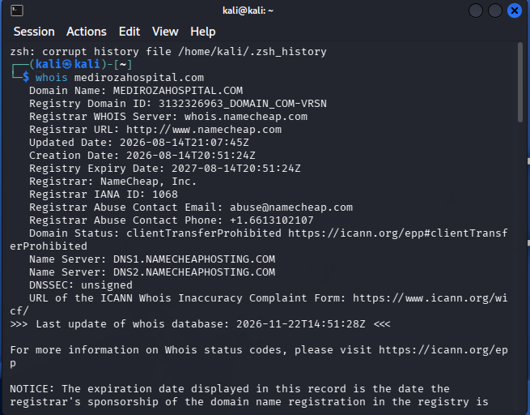
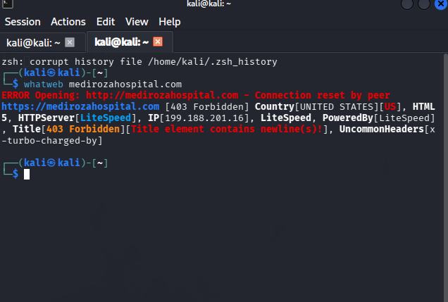
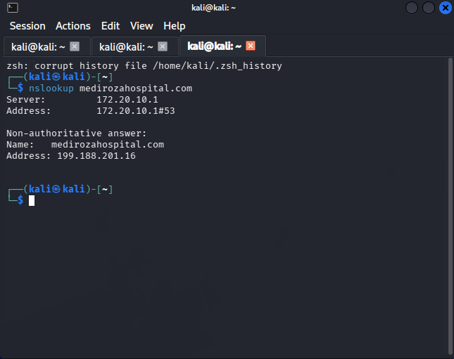
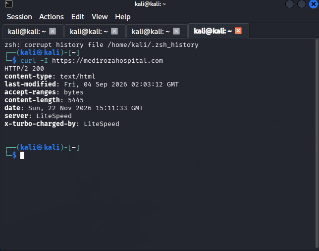
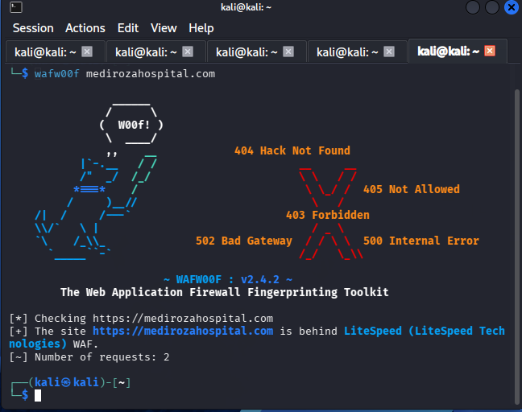
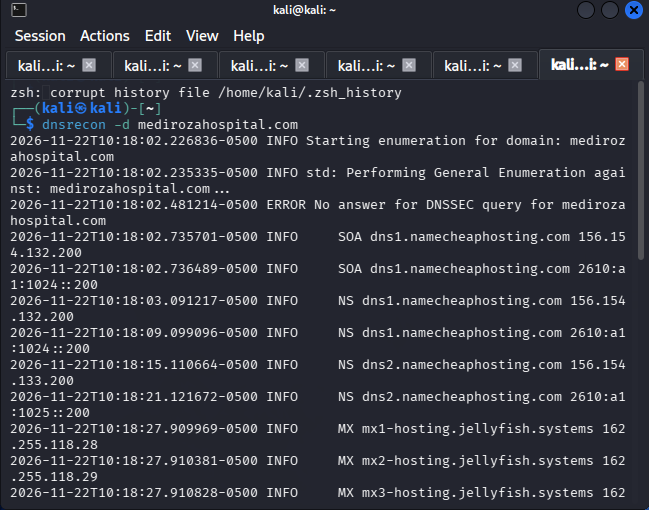
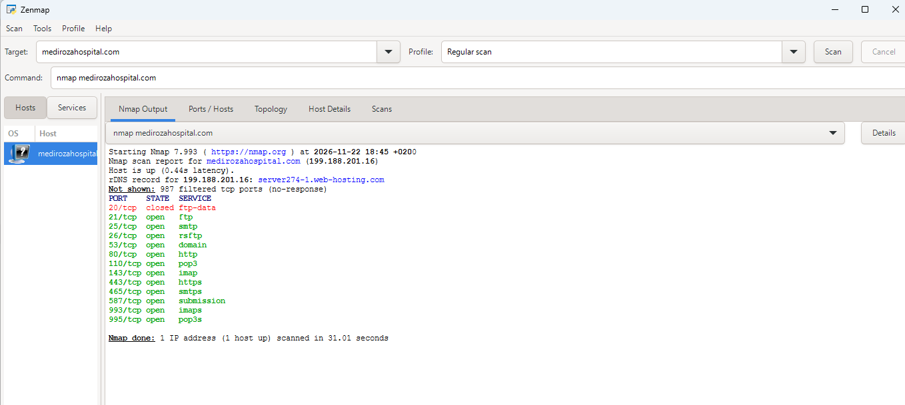
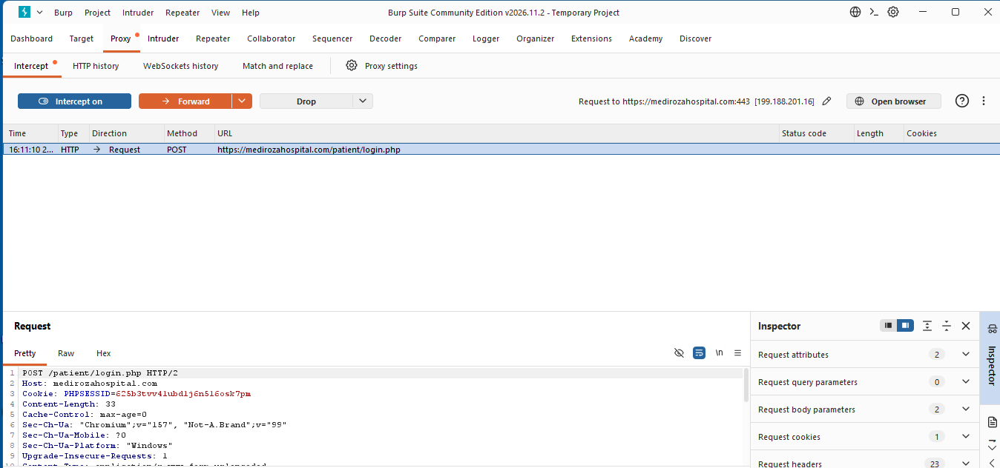
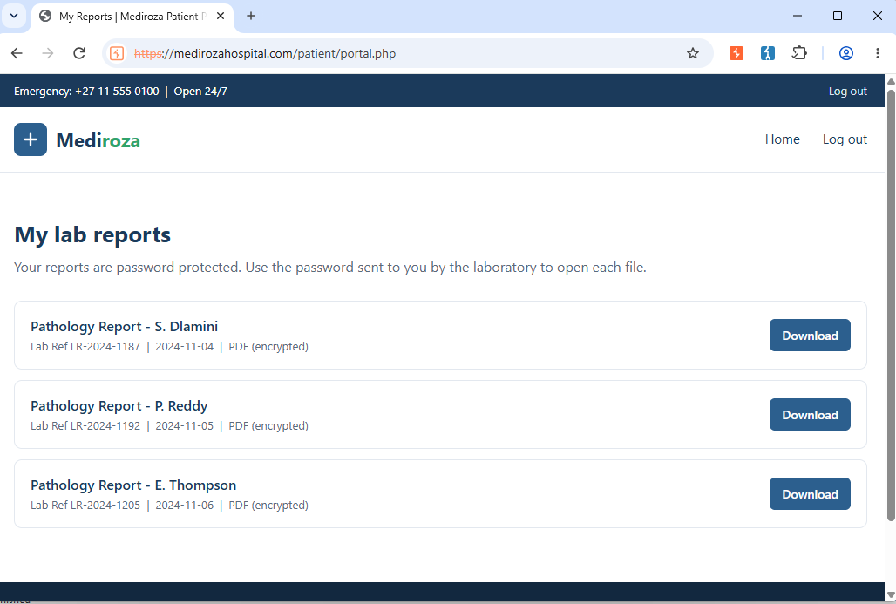

# PENETRATION TESTING REPORT

### MEDIROZA GENERAL HOSPITAL

**Authorised Black-Box Penetration Test**

 

  

**Prepared by:** Kelvin Kayamba  
**Programme:** NetworkWalks Cybersecurity & Ethical Hacking Internship  
**Project:** Week 4  
**Target:** `https://medirozahospital.com`  
**Assessment duration:** Five days  
**Report classification:** Confidential – Authorised Personnel Only  
**Report status:** Final project report

---

## REPORT OVERVIEW

| Report detail | Description |
|---|---|
| Client | Mediroza General Hospital |
| Target domain | `https://medirozahospital.com` |
| Assessment type | Authorised Black-Box Penetration Test |
| Programme | NetworkWalks Cybersecurity & Ethical Hacking Internship |
| Batch | B084 |
| Project | Week 4 |
| Duration | Five days |
| Overall risk | CRITICAL |
| Report status | Final project report |

---

# 1. Executive Summary

A black-box penetration test was conducted against the Mediroza General Hospital web application as part of the NetworkWalks Cybersecurity & Ethical Hacking Internship, Week 4 practical assessment.

The assessment focused on identifying exposed entry points, evaluating authentication behaviour, retrieving three confidential patient laboratory reports, recovering access to the protected PDF documents, and investigating the exposure of employee salary and shareholder information.

The assessment identified several security weaknesses with significant confidentiality implications:

1. Weaknesses in the patient portal authentication process allowed successful access to a restricted patient area during testing.
2. Three patient laboratory report PDFs were retrieved and their password protection was successfully overcome.
3. A publicly accessible historical SQL database backup was discovered in the website's `/old/` directory.
4. The recovered database contained staff records, including employee names, job titles, departments, contact details, national identification information and monthly salaries.
5. The database also contained shareholder information, including names, share percentages, shares held and share classes.
6. The assessment identified missing recommended HTTP security headers.

The most serious issues were the exposure of confidential patient documents and the publicly accessible database backup. These weaknesses could expose sensitive personal, medical, employment and corporate information.

**Overall risk assessment: CRITICAL.**

This overall rating reflects the combined impact of the confirmed sensitive-data exposures. It does not mean that every individual finding is rated Critical.

The assessment was conducted within the authorised educational environment and the agreed target scope. This report documents the activities performed, evidence collected, risks identified and recommended remediation measures.

---

# 2. Scope and Authorisation

## 2.1 Assessment scope

| Item | Description |
|---|---|
| Client | Mediroza General Hospital |
| Target domain | `https://medirozahospital.com` |
| Assessment type | Black-box penetration test |
| Duration | Five days |
| Project | NetworkWalks Week 4 – Batch B084 |
| Authorisation | Written permission granted in the project brief |

The assessment was limited to the specified target domain.

## 2.2 Rules of engagement

The project brief authorised security testing of the target web infrastructure and established the following restrictions:

- Testing limited to the target domain.
- No social engineering.
- No denial-of-service testing.
- No testing outside the agreed scope.

All activities described in this report relate to the authorised practical assessment.

## 2.3 Assessment objectives

The objectives were to:

- Conduct reconnaissance and identify exposed services.
- Identify and assess website entry points.
- Evaluate the patient portal authentication process.
- Retrieve the three confidential patient PDF laboratory reports.
- Recover access to all three protected PDF files.
- Investigate the retrieved files and related exposed resources.
- Identify employee salary information.
- Identify shareholder information.
- Document findings, evidence, severity and remediation recommendations.

---

# 3. Methodology and Tools

The assessment followed a structured black-box testing approach.

## 3.1 Reconnaissance and information gathering

Initial reconnaissance was performed to understand the target's externally visible infrastructure and identify potential entry points.

Tools and techniques used included:

- DNSRecon
- nslookup
- WHOIS
- Zenmap / Nmap
- WhatWeb
- wafw00f
- curl

The reconnaissance phase included DNS and domain information gathering, service discovery, web technology identification and initial inspection of the website's HTTP responses.

The evidence documented the target IP address as `199.188.201.16` and identified several exposed network services.

The observed services included FTP, SMTP, DNS, HTTP, POP3, IMAP, HTTPS and associated mail services, together with additional services identified during scanning.

The presence of an exposed service does not automatically establish a vulnerability. Each service should be assessed according to its necessity, configuration, patch status and access restrictions.

### Figure 1 – Initial reconnaissance and domain information gathering

## 1. Reconnaissance and Information Gathering

### WHOIS Lookup

### WhatWeb Technology Detection

### NSLOOKUP DNS Enumeration

### CURL HTTP Response Analysis

### WAFW00F Detection

### DNSRecon DNS Enumeration

### Figure 2 – Network service discovery and web technology identification

### Nmap Network Scan Results

## 3.2 Authentication and application testing

Burp Suite Community Edition was used to intercept and inspect HTTP requests submitted through the patient login page.

The assessment examined:

- Login request parameters.
- Server responses to authentication attempts.
- Differences between unsuccessful and successful responses.
- Application behaviour during controlled password testing.
- Access to the restricted patient portal.

## 3.3 PDF password recovery

The three retrieved PDF documents were examined to identify their password-protection characteristics.

PDF hash extraction and password-recovery techniques were used to test whether the document protection could be overcome using the available methods and wordlists.

## 3.4 Database backup analysis

The recovered SQL backup was imported into a local analysis environment using phpMyAdmin.

The database was examined to identify the presence of employee and shareholder information.

The database analysis was performed locally on the recovered backup. This should not be interpreted as evidence that the website's remote phpMyAdmin interface was compromised.

## 3.5 HTTP security-header assessment

The website's HTTP response headers were examined to identify the presence or absence of recommended browser security controls.

---

# 4. Findings and Proof of Exploitation

The findings below are organised by the relevant Week 4 milestones.

## 4.1 M1 – Initial Access

### Finding F01: Patient portal authentication weakness

**Severity: HIGH**

**Description**

The patient login page was identified as an accessible application entry point.

Burp Suite Community Edition was used to intercept and inspect the login request. During controlled testing, the authentication process was examined through the submitted HTTP POST request and the corresponding server responses.

The testing identified a successful authentication response and access to the restricted patient portal.

This demonstrates that the authentication process was susceptible to the tested password-guessing approach under the conditions of the assessment.

**Evidence of impact**

Successful access to the patient portal enabled retrieval of the three patient laboratory report PDFs required by the project.

**Security impact**

An attacker able to reproduce the weakness could potentially gain access to patient information without legitimate authorisation. The impact depends on the strength of the authentication controls and whether access is restricted appropriately to individual patients.

**Recommendation**

- Enforce strong password requirements.
- Implement multi-factor authentication where appropriate.
- Apply rate limiting and progressive delays to repeated failed login attempts.
- Implement account lockout or risk-based authentication controls.
- Monitor and alert on repeated authentication failures.
- Use secure session management and session expiration.
- Avoid revealing unnecessary authentication information in server responses.

### Figure 3 – Patient portal authentication request intercepted using Burp Suite

### Figure 4 – Successful access to the patient portal during authorised testing

---

### Finding F02: Retrieval of three confidential patient laboratory reports

**Severity: CRITICAL**

**Description**

Following successful access to the patient portal, three patient laboratory report PDF documents were identified and retrieved.

The documents were:

| Document | Report reference |
|---|---|
| Patient report 1 | LR-2024-1187 |
| Patient report 2 | LR-2024-1192 |
| Patient report 3 | LR-2024-1205 |

The retrieved files were named:

- `patient_report_1.pdf`
- `patient_report_2.pdf`
- `patient_report_3.pdf`

The retrieval of these documents demonstrated exposure of confidential patient laboratory reports through the tested application access path.

**Security impact**

Patient laboratory reports contain sensitive medical information. Unauthorised disclosure could result in privacy violations, reputational damage, regulatory consequences and potential harm to affected individuals.

**Recommendation**

- Enforce server-side authorisation checks for every patient document.
- Ensure patients can access only their own records.
- Do not rely on knowledge of a document URL or identifier as an access-control mechanism.
- Store patient documents outside publicly accessible directories.
- Use short-lived, authenticated download links where appropriate.
- Log and monitor access to medical documents.
- Conduct a review of historical document-access logs to identify possible unauthorised access.

### Figure 5 – Retrieval of the three patient laboratory report PDFs

Evidence PDF pages 33–37.

---

## 4.2 M2 – Data Extraction and PDF Password Recovery

### Finding F03: Weak PDF document password protection

**Severity: HIGH**

**Description**

The three retrieved PDF reports were examined to determine whether their password protection could be overcome.

The assessment involved extracting the relevant PDF password hashes and applying password-recovery techniques using available tools and wordlists.

The project evidence documents successful password recovery and access to all three PDF files.

The assessment demonstrated that the password protection applied to the documents was insufficient to prevent recovery using the methods tested.

**Evidence of impact**

All three retrieved PDF reports were successfully opened after the password-recovery process.

The recovered passwords are intentionally not reproduced in this report because they are associated with confidential patient documents.

**Security impact**

Weak document passwords can allow an individual who obtains a protected file to recover its contents. Password protection should not be treated as a substitute for access controls or secure document storage.

**Recommendation**

- Use strong, randomly generated document passwords where PDF encryption is required.
- Avoid predictable, reused or easily guessed passwords.
- Use modern encryption settings supported by the document format and approved organisational policy.
- Distribute document passwords through a separate secure channel.
- Restrict access to the original documents before download.
- Consider secure authenticated document delivery rather than relying on password-protected PDFs alone.

### Figure 6 – Extraction of password hashes from the retrieved PDF documents

Evidence PDF pages 20–32.

### Figure 7 – Successful recovery of PDF document passwords during testing

Evidence PDF pages 20–32.

### Figure 8 – Verification of successful access to a protected patient report

Evidence PDF pages 33–37.

---

## 4.3 M3 – Critical Data Exposure on the Client Server

### Finding F04: Publicly accessible historical SQL database backup

**Severity: CRITICAL**

**Description**

During examination of the target website, an exposed `/old/` directory was identified.

Within this directory, the assessment discovered a historical SQL database backup named:

`mediroza_db_backup_2019.sql`

The backup was retrieved and imported into a local analysis environment using phpMyAdmin.

This demonstrated that a database backup containing sensitive organisational information was accessible through the website.

**Security impact**

A publicly accessible database backup can expose substantial quantities of information without requiring an attacker to compromise the live database directly.

Depending on the contents, such a backup may expose personal information, employee records, financial information and confidential business records.

**Recommendation**

- Remove database backups from publicly accessible web directories immediately.
- Store backups outside the web root in restricted storage.
- Apply strict access controls to backup repositories.
- Encrypt database backups at rest.
- Use secure backup-transfer procedures.
- Disable directory listing.
- Review web server access logs for requests to backup files.
- Rotate credentials or secrets if the backup contains them.
- Establish a retention policy for historical backups.

### Figure 9 – Discovery of the historical SQL database backup in the exposed directory

Evidence PDF page 38.

---

### Finding F05: Exposure of employee personal and salary information

**Severity: CRITICAL**

**Description**

The recovered SQL backup contained a `staff` table with 30 employee records.

The table included the following fields:

| Field | Description |
|---|---|
| full_name | Employee full name |
| job_title | Employee job title |
| department | Department |
| email | Employee email address |
| phone | Employee telephone number |
| national_id | National identification information |
| monthly_salary_zar | Monthly salary in South African rand |
| date_joined | Employment start date |

The presence of these records demonstrated exposure of employee personal and employment information, including salary and national identification data.

**Security impact**

Unauthorised access to employee records can enable identity theft, targeted phishing, social engineering, privacy violations and disclosure of confidential remuneration information.

**Recommendation**

- Restrict employee records to authorised HR and management personnel.
- Apply role-based access controls.
- Encrypt sensitive personal information.
- Minimise the amount of personal information stored in backups.
- Remove unnecessary historical records in accordance with retention policies.
- Review access logs and investigate possible unauthorised downloads.
- Apply appropriate data-protection controls to employee identification and salary information.

### Figure 10 – Database analysis identifying the employee staff table and sensitive fields

Evidence PDF pages 39–44.

### Figure 11 – Evidence of employee records and salary information stored in the exposed database backup

Evidence PDF pages 39–44.

**Redaction required:** Redact employee names, national identification numbers, telephone numbers, email addresses and exact salary values before sharing the report beyond the authorised assessment environment.

---

### Finding F06: Exposure of shareholder information

**Severity: HIGH**

**Description**

The recovered SQL backup also contained a `shareholders` table with 10 records.

The table included the following fields:

| Field | Description |
|---|---|
| shareholder_name | Shareholder name |
| share_percent | Percentage of shares held |
| shares_held | Number of shares held |
| share_class | Share classification |

This demonstrated exposure of confidential shareholder and ownership information through the publicly accessible database backup.

**Security impact**

Shareholder information may be commercially sensitive. Unauthorised disclosure could expose ownership structures, create opportunities for targeted fraud and reveal information that should be restricted to authorised stakeholders.

**Recommendation**

- Restrict shareholder records to authorised corporate and financial personnel.
- Apply role-based access controls.
- Encrypt sensitive corporate records and backups.
- Store backups in secure, non-public locations.
- Review historical access to the exposed backup.
- Apply appropriate retention and disclosure policies.

### Figure 12 – Identification of the shareholder information table in the recovered database

Evidence PDF pages 39–44.

### Figure 13 – Evidence of shareholder ownership information stored in the exposed database backup

Evidence PDF pages 39–44.

**Redaction required:** Redact names and exact ownership details where the report will be distributed beyond the authorised assessment environment.

---

## 4.4 Additional Security Observations

### Finding F07: Missing recommended HTTP security headers

**Severity: MEDIUM**

**Description**

The HTTP security-header assessment identified several recommended security headers that were not present in the responses examined.

The assessment evidence recorded a security-header score of 11/100, with one control present and eight controls missing.

The headers reviewed included:

- Strict-Transport-Security (HSTS)
- Content-Security-Policy (CSP)
- X-Frame-Options
- X-Content-Type-Options
- Referrer-Policy
- Permissions-Policy
- Cross-Origin-Opener-Policy (COOP)
- X-XSS-Protection (legacy header)

The absence of these headers does not independently prove that an exploitable vulnerability exists. However, it indicates that recommended browser-side security protections may not be fully configured.

**Security impact**

Depending on the application's functionality and other controls, missing security headers may increase exposure to certain browser-based attacks, including clickjacking, content injection and unintended information disclosure.

**Recommendation**

- Configure an appropriate Content-Security-Policy.
- Enable HTTP Strict Transport Security after confirming HTTPS is correctly configured.
- Configure X-Content-Type-Options: nosniff.
- Set an appropriate Referrer-Policy.
- Configure Permissions-Policy according to application requirements.
- Use an appropriate frame-ancestors directive or X-Frame-Options.
- Configure Cross-Origin-Opener-Policy where appropriate.
- Do not rely on the deprecated X-XSS-Protection header as a replacement for modern controls.

### Figure 14 – HTTP security-header assessment identifying missing recommended browser security controls

Evidence PDF pages 45–46.

---

### Finding F08: Externally exposed network services

**Severity: MEDIUM – Requires further validation**

**Description**

The reconnaissance and service-discovery phase identified multiple externally visible services on the target infrastructure.

The observed services included web, DNS, FTP and mail-related services, together with additional ports identified during scanning.

The presence of these services is not, by itself, proof of a security vulnerability. Their risk depends on whether they are necessary, securely configured, patched and appropriately restricted.

**Recommendation**

- Review all externally accessible services.
- Disable services that are not required.
- Restrict administrative and management interfaces.
- Apply current security patches.
- Enforce secure protocols and authentication.
- Restrict access to services using firewall rules and network segmentation.
- Conduct configuration reviews for exposed FTP and mail services.
- Monitor service access and suspicious connection attempts.

**Evidence**

Use the network scanning screenshot already inserted as Figure 2. Avoid duplicating the same screenshot unless a separate image clearly demonstrates the additional exposed services.

---

# 5. Staff Login Page Assessment

The staff login page at:

`https://medirozahospital.com/staff/login.php`

was identified as another application entry point.

The page presented a login form requesting a Staff ID and password. The available evidence documents the login interface and its assessment as part of the wider application review.

**Important qualification:** The evidence reviewed does not establish successful unauthorised access to the staff portal. Therefore, this report does not classify the staff login page as a confirmed authentication bypass.

The staff login page should nevertheless be assessed for:

- Strong authentication requirements.
- Rate limiting and protection against password guessing.
- Multi-factor authentication.
- Secure session handling.
- Appropriate error messages.
- Role-based access controls.
- Monitoring of failed and successful login attempts.

### Optional Figure 15 – Staff portal login interface identified during application assessment

Insert a screenshot of the staff login page only if it is present in your original evidence.

---

# 6. Risk Rating Summary

The following ratings reflect the demonstrated impact and the evidence available from the assessment.

| ID | Finding | Severity |
|---|---|---|
| F01 | Patient portal authentication weakness | HIGH |
| F02 | Retrieval of confidential patient reports | CRITICAL |
| F03 | Weak PDF document password protection | HIGH |
| F04 | Publicly accessible historical SQL backup | CRITICAL |
| F05 | Employee personal and salary information exposure | CRITICAL |
| F06 | Shareholder information exposure | HIGH |
| F07 | Missing recommended HTTP security headers | MEDIUM |
| F08 | Externally exposed network services | MEDIUM – requires further validation |

## 6.1 Severity justification

**Critical:** The issue creates a direct and significant risk to highly sensitive information, including patient medical reports and employee personal and salary records. Public access to a database backup containing these records presents a substantial confidentiality risk.

**High:** The issue could enable unauthorised access to restricted information or expose commercially sensitive data. The patient authentication weakness and recoverable PDF passwords increase the likelihood of unauthorised access to confidential documents.

**Medium:** The issue represents a security weakness that could increase the attack surface or reduce defence-in-depth. Further validation is required before concluding that exposed services or missing headers are independently exploitable.

These ratings are qualitative project risk assessments. They are not formal CVSS scores.

---

# 7. Overall Risk Assessment

The overall risk is Critical because the assessment demonstrated multiple routes to the exposure of highly sensitive information.

The most significant concerns are:

1. Access to confidential patient laboratory reports.
2. Recoverable password protection on the retrieved PDF files.
3. Public accessibility of a historical database backup.
4. Exposure of employee identification and salary records.
5. Exposure of shareholder ownership information.

The exposed database backup represents a particularly serious issue because it contains several categories of confidential information in a single downloadable resource.

The organisation should prioritise removing the exposed backup and investigating whether it or the patient reports were accessed by unauthorised parties.

---

# 8. Recommendations and Remediation Priority

The following remediation actions are recommended in priority order.

| Priority | Recommended action | Reason |
|---|---|---|
| Immediate | Remove the exposed SQL backup from the public web directory | Prevent further unauthorised retrieval |
| Immediate | Investigate access logs for the backup and patient reports | Establish whether data was accessed or downloaded |
| Immediate | Restrict access to patient laboratory reports | Protect confidential medical information |
| Immediate | Review patient portal authentication controls | Reduce the risk of unauthorised access |
| High | Review and secure all database backups | Prevent future backup exposure |
| High | Restrict employee and shareholder information | Protect personal and corporate records |
| High | Strengthen PDF encryption and password practices | Reduce the risk of document password recovery |
| High | Review externally exposed services | Reduce unnecessary attack surface |
| Medium | Configure recommended HTTP security headers | Improve browser-side protection |
| Medium | Establish recurring vulnerability assessments | Identify weaknesses before exploitation |

## 8.1 Immediate containment

The organisation should first remove the exposed SQL backup from public access and preserve a secured forensic copy for investigation.

Access logs should be reviewed to identify requests to the `/old/` directory and the patient report resources.

Where evidence indicates that sensitive information may have been accessed by unauthorised parties, the organisation should follow its incident-response and data-breach procedures.

## 8.2 Authentication improvements

The patient portal should be reviewed to ensure that repeated login attempts are restricted and that users can only access records belonging to their own accounts.

Strong passwords, multi-factor authentication, secure session handling and appropriate monitoring should be implemented.

## 8.3 Data protection improvements

Employee, patient and shareholder information should be stored in protected systems with access granted only to authorised personnel.

Database backups should never be stored in publicly accessible web directories.

---

# 9. Assessment Limitations

This report is based on the activities and evidence documented during the NetworkWalks Week 4 practical assessment.

The following limitations apply:

- The assessment was limited to the target domain and the authorised project scope.
- No social engineering or denial-of-service testing was conducted.
- The presence of exposed services was documented, but the existence of a vulnerability in every exposed service was not established.
- The staff login interface was identified, but successful unauthorised staff portal access was not demonstrated in the evidence reviewed.
- The database was imported into a local phpMyAdmin environment for analysis. This does not establish that a remote database administration interface was compromised.
- The assessment does not establish whether the exposed data was accessed by an external attacker before the test.
- No formal CVSS scoring or independent post-remediation verification was performed.

The findings should therefore be interpreted within the scope of the demonstrated testing and the available evidence.

---

# 10. Conclusion

The NetworkWalks Week 4 penetration-testing assessment demonstrated several significant security weaknesses affecting the Mediroza General Hospital web application.

The assessment successfully identified the patient portal as an entry point, retrieved the three required patient laboratory report PDFs, recovered access to the protected documents and discovered a publicly accessible historical SQL database backup.

Analysis of the recovered database revealed employee records containing personal and salary information, as well as shareholder ownership information.

The findings demonstrate the importance of secure authentication, proper access control, secure backup storage, strong document protection and effective handling of confidential information.

The most urgent remediation actions are to remove the exposed database backup from public access, investigate possible unauthorised access, secure patient documents and strengthen authentication controls.

The overall risk is assessed as **CRITICAL** because of the demonstrated exposure of sensitive patient and organisational information.

---

## END OF REPORT

**Prepared by Kelvin Kayamba**

NetworkWalks Cybersecurity & Ethical Hacking Internship  
**Batch B084 | Project Week 4**

Confidential – Authorised Personnel Only

